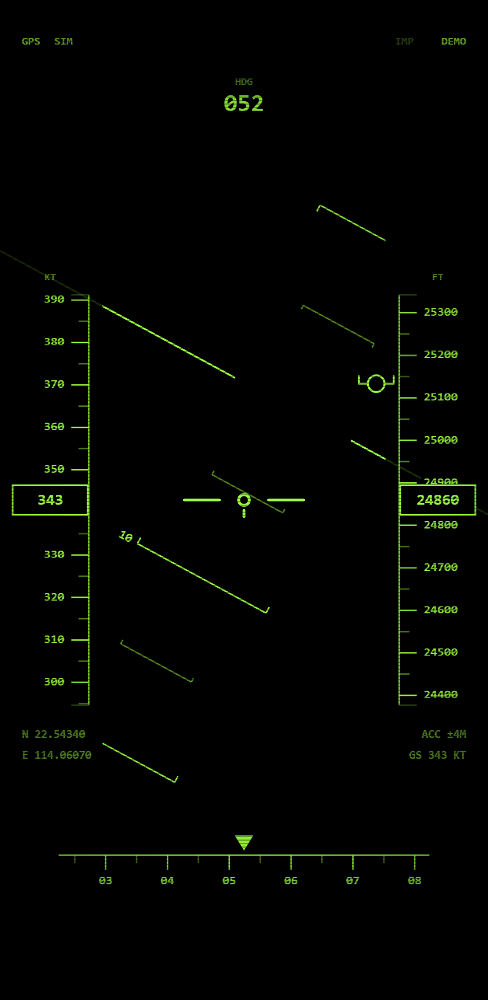

# HUD 抬头显示

> 把手机变成战斗机抬头显示器。举起手机，地平线、航向、速度和高度跟着你的姿态实时变化。

**中文** | [English](README.en.md)



## 在线体验

<https://hud-headup-display.app.workbuddy.host/?sharecode=L346LRQHPP>

手机浏览器打开即可，无需安装。建议用 Chrome / Safari，并把它「添加到主屏幕」，之后从图标进入没有地址栏，接近原生 App。

## 特性

- **姿态指示器** — 俯仰梯随抬头低头平移、随左右倾斜旋转，10° 一个刻度并标数字
- **航向** — 顶部三位数字 + 底部滚动罗盘带
- **速度 / 高度滚动带** — 中央读数框，数字朝屏幕外侧，支持英制（KT · FT）与公制（KPH · M）
- **飞行路径矢量** — 圆圈加两侧短翼，指示真实运动方向；转弯时会明显甩向一侧
- **CRT 质感** — 荧光辉光叠加扫描线与暗角，两套配色（绿色 / 琥珀）

## 操作

| 手势 | 作用 |
| --- | --- |
| 点一下屏幕 | 右上角出现设置按钮，3 秒后自动隐藏 |
| 双击 | 切换公制 / 英制 |
| 长按 0.9 秒 | 把当前姿态校准为基准（归零） |

设置菜单里可以切换数据源、屏幕方向、速度倍率、前向速度、主题和单位。

## 设置项

| 项目 | 选项 | 说明 |
| --- | --- | --- |
| 数据源 | GPS / 加速度 | GPS 用卫星定位；加速度用传感器积分推算 |
| 屏幕方向 | 竖屏 / 横屏 | 横屏为软件旋转，不依赖系统的方向锁定 |
| 速度倍率 | 1× / 10× / 100× | 放大传感器测到的微小速度，仅加速度模式有效 |
| 前向速度 | 0 / 10 / 100 m/s | 叠加一个恒定向前矢量，模拟持续飞行 |
| 主题 | 绿色 / 琥珀 | 点击即时生效 |
| 单位 | 英制 / 公制 | 与双击手势等价 |

## 本地运行

整个应用是一个 `index.html`，没有任何外部依赖，也不需要构建。

**关键：必须通过 `https://` 或 `localhost` 打开。** 浏览器只在「安全上下文」里提供传感器和定位，用 `file://` 直接双击打开会拿不到数据，页面会自动进入演示模式。

最简单的本地起法：

```bash
# 任选其一
python3 -m http.server 8080
npx serve .
```

然后访问 <http://localhost:8080>。注意用 `localhost` 而非局域网 IP，后者同样不算安全上下文。

想在另一台设备上访问，需要 https。仓库里不含证书，可以自己用 `openssl` 签一张自签名证书，浏览器提示不安全时点「继续前往」即可。

## 技术说明

- **姿态解算**用于完整的旋转矩阵，而不是直接读 `beta` / `gamma`。竖持手机时「绕屏幕法线倾斜」会同时改变两个欧拉角，直接取值在横屏和倒置时会算错；矩阵法在任意朝向都成立，横屏时再按 `screen.orientation.angle` 混合分量做补偿。
- **加速度模式**对去重力后的线性加速度积分得到速度，配阻尼与零偏估计抑制漂移。物理上加速度只能反映速度变化，匀速时积分为零，所以这个模式下的速度会缓慢回落，属于预期行为。
- **车削/转向侧滑**由航向角速度直接生成，转弯瞬间偏转、停手立即回中，比靠低通滞后更跟手。
- **GPS** 数据经中值滤波 + 精度门槛处理，精度差时不采信高度，避免读数乱跳。
- 双 canvas 渲染：一层模糊做辉光，一层保证清晰文字。

## 浏览器要求

- 需要 **HTTPS 或 localhost**（传感器与定位的前置条件）
- iOS 13+ 首次进入需点击按钮授权「运动与方向」
- 安卓 Chrome / Edge 直接可用

## 已知限制

- 加速度模式的速度是积分结果，长时间匀速运动后会回落到零
- 室内通常收不到 GPS，此时显示的是演示数据，状态栏会标 `SIM`
- 精度完全取决于手机传感器的素质，不同机型差异明显

## 许可

[Apache License 2.0](LICENSE)
